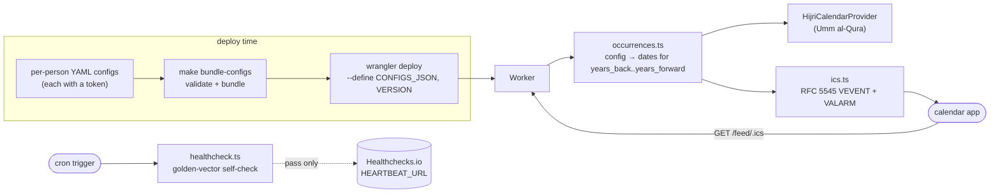
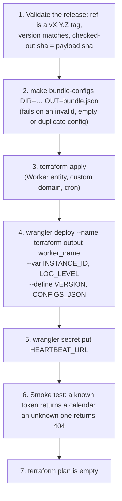

# hijri-cadence

A serverless Hijri-calendar event feed. Point your calendar app at a
`webcal://` URL and get always-current Gregorian dates for events kept on
the Hijri calendar: birthdays, anniversaries, family observances.

This README is the manual: what it does, how it works, every `make`
target, and how to deploy your own instance. Update it in the same PR as
any change to a target, a config field, a secret or a deploy step.
`make docs-check` fails CI when a target is missing from it.

- [Why](#why)
- [What you get](#what-you-get)
- [How it works](#how-it-works)
- [Subscribing](#subscribing)
- [Writing a config](#writing-a-config)
- [Development](#development)
- [Self-hosting](#self-hosting)
- [Releases](#releases)
- [CI](#ci)
- [Non-goals](#non-goals)
- [Repo layout](#repo-layout)

## Why

Google Calendar and most other mainstream calendar apps have no concept of
Hijri-date recurrence. A Hijri-yearly event moves about 10–11 days earlier
on the Gregorian calendar each year, so a yearly `RRULE` is wrong as soon
as it is created.

hijri-cadence is a small Cloudflare Worker. It reads a static YAML config
of events and serves an ICS feed covering a rolling window of years,
recomputed on every request.

## What you get

- A live subscription URL: `https://<your-host>/feed/<token>.ics`
- Umm al-Qura Hijri↔Gregorian conversion by default, behind a pluggable
  `HijriCalendarProvider` interface
- Reminders: one `VALARM` per entry in `reminder_days_before`
- An optional Hijri birth year, which adds the age to the event title
- Month-end handling: in a year where the month has only 29 days, an event
  on the 30th is observed on the 29th, and the event description says why
- A local CLI (`make ical`) that writes an `.ics` file without deploying
- Golden-vector unit tests, plus a spot-check against the Aladhan API
  (needs the network, so it is never run in CI)

## How it works



- **No state at runtime.** Configs are baked into the bundle at build
  time, so the Worker has no D1, KV or R2. A config change means a
  redeploy.
- **The token is the access control.** It is base62 and at least 22
  characters long (≥128 bits). An unknown token gets a 404, and logs only
  ever contain a hash of it.
- **The cron self-check** converts known golden dates on every tick, and
  pings Healthchecks.io only if every one of them matches.

The full design is in [`docs/architecture.md`](docs/architecture.md).

## Subscribing

Each feed URL contains a secret token, and anyone with the URL can read
the feed, so share it like a password.

- **Apple Calendar:** File → New Calendar Subscription → paste
  `webcal://<host>/feed/<token>.ics`. Reminders (`VALARM`) are honoured
  unless you tick "Remove alerts".
- **Google Calendar:** Other calendars → + → From URL → paste
  `https://<host>/feed/<token>.ics`. Google refreshes subscriptions on
  its own schedule (often every 12–24 hours) and **ignores reminders** in
  subscribed feeds, so set notifications on the calendar itself.
- **Outlook:** Add calendar → Subscribe from web.

## Writing a config

[`examples/events.example.yaml`](examples/events.example.yaml) is a
fictitious, complete example. `worker/src/config.ts` validates every
field:

| Field                                           | Required               | Meaning                                       |
| ----------------------------------------------- | ---------------------- | --------------------------------------------- |
| `token`                                         | in a deployable config | base62, ≥ 22 characters; becomes the feed URL |
| `calendar`                                      | yes                    | `umm_al_qura` (the only provider in v1)       |
| `occurrence_range.years_back` / `years_forward` | no (3 / 6)             | The rolling window, in Hijri years            |
| `events[].name`                                 | yes                    | Event title                                   |
| `events[].hijri_day`, `hijri_month`             | yes                    | The date in the Hijri calendar                |
| `events[].hijri_year`                           | no                     | Birth year; adds the age suffix               |
| `events[].reminder_days_before`                 | no (`[]`)              | One `VALARM` per entry                        |

```sh
make validate-configs DIR=configs/                          # validate a directory of configs
make ical CONFIG=examples/events.example.yaml OUT=/tmp/events.ics   # render one to disk
```

Validation errors name the file and the field path, never the value.

## Development

Requirements: Node 22+ and pnpm. Terraform
1.10+ is only needed for `make tf-check`.

```sh
make install       # pnpm install --frozen-lockfile
make dev           # wrangler dev; every feed 404s without real configs
make test          # Tier 1 unit tests, no network
make typecheck
make lint
make format        # Prettier --write
make format-check  # Prettier --check
make check         # everything CI gates on: typecheck, lint, format-check, test, docs-check
make spot-check    # Tier 3: golden dates against the Aladhan API (network)
make tf-check      # terraform fmt -check + validate on the module, no credentials
make docs-check    # this README covers every target, and every link resolves
```

`make help` lists every target. There are three test tiers:

| Tier | Where                       | Runs                                |
| ---- | --------------------------- | ----------------------------------- |
| 1    | `worker/test/*.test.ts`     | `make test`, on every PR            |
| 2    | `worker/src/healthcheck.ts` | in the deployed Worker, on its cron |
| 3    | `worker/test/spot-check/`   | `make spot-check`, on demand only   |

The local-development guide is in [`docs/setup.md`](docs/setup.md).

## Self-hosting

Deployment happens outside this repository. Your configs and tokens, your
account and zone IDs, and your credentials are supplied at deploy time and
never committed here.

### What you provide

- A Cloudflare account and a zone for the feed hostname. Use a
  first-level subdomain: Universal SSL does not cover deeper names.
- An R2 bucket, or another S3-compatible backend, for Terraform state.
- A Cloudflare API token scoped to Workers Scripts, the zone's Workers
  Routes and DNS.
- One YAML config per feed, each with its own token.
- Optionally, a Healthchecks.io check for the self-check.

The Terraform module, `infrastructure/terraform/_modules/hijri-cadence-environment/`,
takes `cloudflare_account_id`, `instance_id`, `zone_id`, `feed_hostname`,
`cron_schedule` and `cron_enabled`. Every resource name is prefixed with
`hijri-cadence-<instance_id>`, and `instance_id` must be unique for each
instance in an account.

### Deploy steps



The rules that make it work:

- **Terraform owns the Worker entity**, its custom domain and its cron
  trigger. It never uploads code. `wrangler.toml` must never declare
  `[triggers]`, or every deploy overwrites the cron.
- **wrangler owns the code**, the compatibility settings and the vars, and
  is always given `--name`. The committed name is a placeholder.
- **`[observability]` in `wrangler.toml` mirrors the module.** Every upload
  resets any observability setting it omits, so step 7 catches a mismatch.
- **`HEARTBEAT_URL` is a secret**, not a var: whoever holds it can ping the
  check. Set it after `wrangler deploy`, because a secret cannot share a
  name with a var.

[`docs/architecture.md`](docs/architecture.md#deploying) has the reasoning
behind each step.

### Automating it

When a release is cut, `release-please.yml` sends a `repository_dispatch`
of type `deploy-release` with `{ version, sha, actor, ref }`. It goes to
the repository named in the `DEPLOY_TARGET_REPO` environment secret,
authenticated with `DEPLOY_DISPATCH_TOKEN`. Scope that token to the
target repository only. With step 1 in place, a leaked token can only
redeploy an existing release. To re-send the dispatch for a tag, run
`notify-deploy.yml` by hand. Leave both secrets unset to deploy by hand.

## Releases

release-please reads the squash-merge titles. `feat:` bumps the minor
version and `fix:` the patch; `chore:`, `docs:`, `ci:`, `test:` and
`refactor:` cut nothing. Merging the release PR tags the release, writes
the changelog and fires the dispatch. Tooling and docs are never `feat:`.

## CI

| Workflow              | Runs on                                 | Does                                                                                                                 |
| --------------------- | --------------------------------------- | -------------------------------------------------------------------------------------------------------------------- |
| `pr-checks.yml`       | PR                                      | `make docs-check`, typecheck, lint, format check, Tier 1 tests, a dry-run bundle of the example config, `pnpm audit` |
| `terraform-check.yml` | PR touching `infrastructure/terraform/` | `fmt -check` + `validate`, no credentials                                                                            |
| `release-please.yml`  | push to `main`                          | Maintains the release PR; on a release, fires the deploy dispatch                                                    |
| `notify-deploy.yml`   | manual, with a tag                      | Re-sends the dispatch for an existing tag                                                                            |

## Non-goals

- Moon-sighting-based dates. Umm al-Qura is a fixed tabular calendar.
  It is fine for scheduling, but **not** for determining the start of
  Ramadan or Eid, which depends on sighting.
- Write access or two-way sync. It is a read-only feed, like any ICS
  subscription.
- Dates outside 1343–1500 AH (1924–2077 CE).

## Repo layout

```
hijri-cadence/
├── Makefile                             # every local operation
├── worker/
│   ├── src/
│   │   ├── providers/                   # HijriCalendarProvider + Umm al-Qura
│   │   ├── config.ts                    # YAML parse + zod validation
│   │   ├── occurrences.ts               # config → occurrences (pure)
│   │   ├── ics.ts                       # occurrences → ICS (pure, RFC 5545)
│   │   ├── feed-handler.ts              # GET/HEAD /feed/<token>.ics
│   │   ├── healthcheck.ts               # cron self-check + ping
│   │   ├── bundle.ts, bundle-cli.ts     # deploy-time validation + bundling
│   │   ├── cli.ts                       # make ical
│   │   └── index.ts
│   └── test/                            # Tier 1; spot-check/ is Tier 3
├── infrastructure/terraform/_modules/hijri-cadence-environment/
├── examples/events.example.yaml         # fictitious sample config
├── scripts/docs-check.sh
└── docs/                                # architecture, setup, design history
```

## License

MIT. See [`LICENSE`](LICENSE).
